<div align="center">

<h1><picture>
  <source media="(prefers-color-scheme: dark)" srcset="docs/logo/kit/catlan-horizontal-dark.svg">
  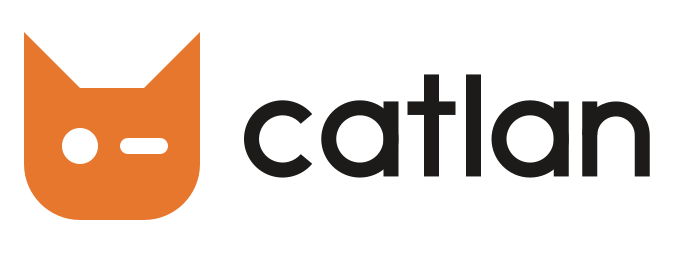
</picture></h1>

**El gato amigo de los IT.** Inventario, wiki, esquemas de red, racks, monitor, salud de equipos e incidencias en una sola web, autoalojada y 100 % local.


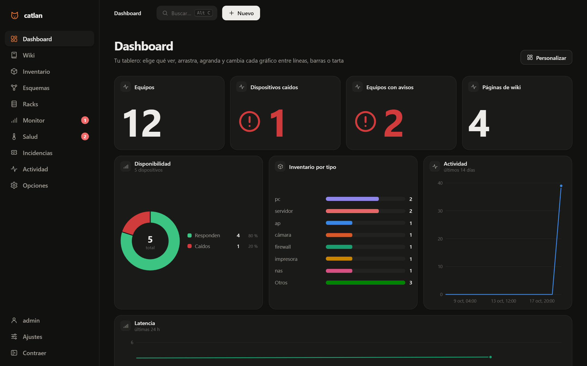

</div>

> [!IMPORTANT]
> **catlan ahora está escrito en Rust.** La versión 1.0 en Python (`catlan.py`) se ha reescrito entera: el servidor es
> un **único ejecutable** (`catlan` / `catlan.exe`) con la web dentro, y Kitty pasa a ser un **programa** con un gato en
> la bandeja para que cada usuario avise a IT. La web, la API, la base de datos, las contraseñas y las copias cifradas
> son **las mismas**: una instalación en Python se actualiza sin perder nada ([cómo](#vienes-de-la-versión-en-python)).

> [!WARNING]
> **Antes de actualizar, haz una copia de `data/`** ([cómo se actualiza](#actualizar-catlan)). Al pasar a la 2.0 hay que
> reinstalar Kitty en los PCs: mira el [CHANGELOG](CHANGELOG.md).

## Novedades

- **Usuarios del dominio**: login con Active Directory (LDAP) y con Entra ID, Google Workspace o Keycloak (OIDC), y sus
  grupos del dominio deciden quién es admin, quién edita y quién solo mira. Mira [Usuarios del dominio](#usuarios-del-dominio-ldap-y-oidc).
- **2.0: HTTPS siempre y Kitty anclado a catlan.** catlan crea su propio certificado si no le das uno, y el comando de
  instalación de Kitty lleva su huella: nadie en la red puede colar otro instalador ni ver la pantalla del control remoto.
  **Hay que reinstalar Kitty** (mismo comando) para el control remoto y las actualizaciones.
- **Cuánto se guarda**, ahora en Administración → Sistema; y probado con 3.000 PCs con Kitty.

Todos los cambios, versión a versión, en [CHANGELOG.md](CHANGELOG.md). Seguridad y cómo avisar de un fallo:
[SECURITY.md](SECURITY.md).

<p align="center">
<picture>
  <source media="(prefers-color-scheme: dark)" srcset="docs/logo/kit/catlan-horizontal-dark.svg">
  
</picture>
  &nbsp;&nbsp;&nbsp;&nbsp;
<picture>
  <source media="(prefers-color-scheme: dark)" srcset="docs/logo/kitty/kit/kitty-horizontal-dark.svg">
  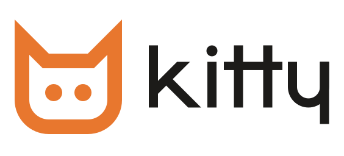
</picture>
</p>

## ¿Qué es?

catlan es la web de un equipo de sistemas para tener **todo enlazado por el ID de cada equipo**: su ficha del inventario,
dónde está montado en el rack, en qué esquema aparece, qué páginas de la wiki lo mencionan, si responde al ping, cómo
van sus discos y qué incidencias tiene abiertas. Con historial de cada cambio.

- **Un solo ejecutable.** La web, SQLite y los instaladores de Kitty van dentro: nada que instalar en el servidor, ni
  Python, ni Node, ni base de datos aparte. Cópialo a una carpeta y arráncalo.
- **Fiable.** Rust: sin errores de tipos en producción, memoria segura y un ejecutable que no depende de lo que haya
  instalado en la máquina. La criptografía (AES, HMAC, PBKDF2, TLS) usa crates revisados de RustCrypto y rustls.
- **Todo local.** Una base de datos SQLite en `data/`. Sin nube, sin cuentas externas, sin analítica ni telemetría; la
  web no carga nada de Internet.
- **En español** y pensada para el día a día de un IT: atajos de teclado, buscador global, tema claro y oscuro, móvil.

## Funciones

| | |
|---|---|
| 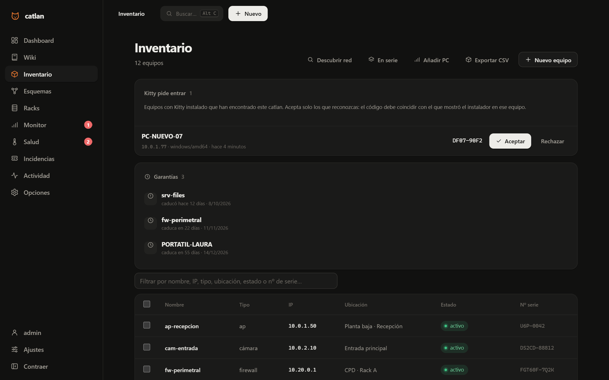 | **Inventario** · equipos con IP, nº de serie, ubicación, estado y fin de garantía. Altas a mano, en serie o **descubriendo la red** (ping, SNMP y DNS). Filtro al vuelo, **exportar a CSV** y las garantías que caducan, arriba y con aviso. |
| 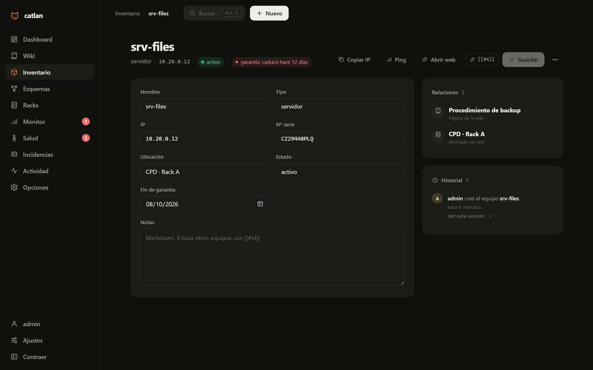 | **Ficha de cada equipo** · copiar IP, ping al momento, abrir su web, su estado en el monitor y todo lo que lo menciona: páginas, esquemas, racks e incidencias. |
| 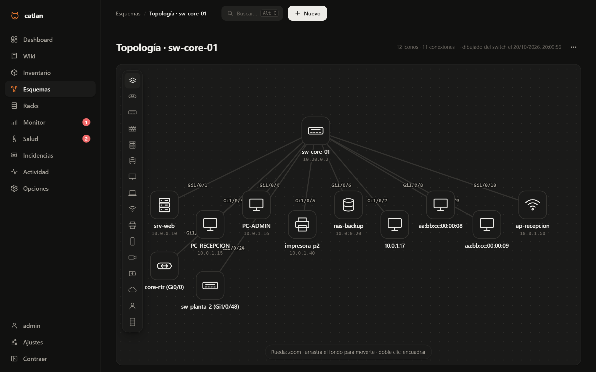 | **Esquemas y topología automática** · diagramas de red con iconos y, con un clic, catlan lee **LLDP, CDP y la tabla MAC** de un switch y dibuja qué equipo está en qué puerto. |
| 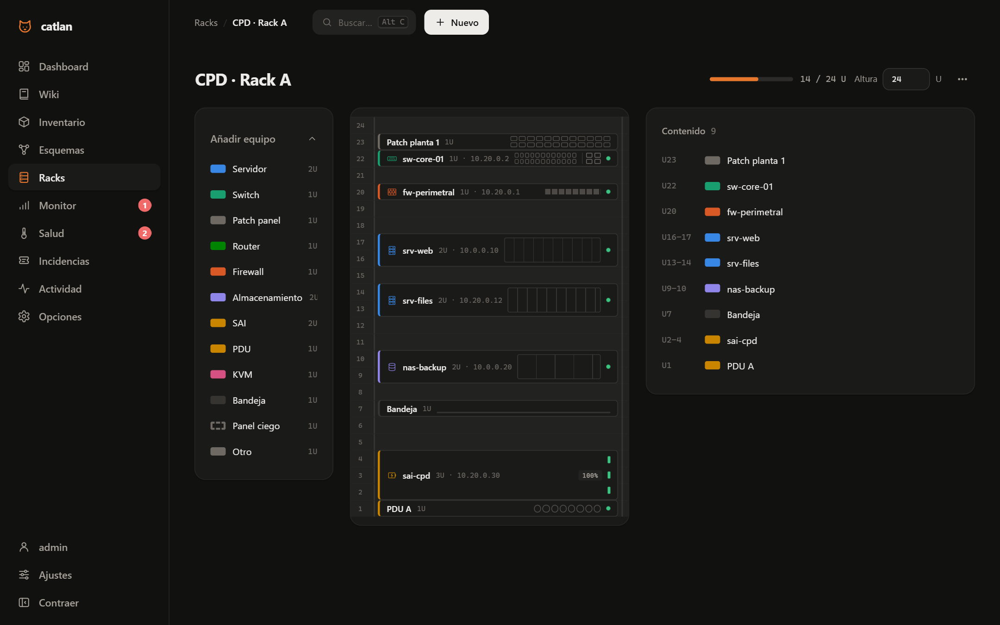 | **Racks** · armarios montados U a U, con bocas de switch, patch panel y PDU anotables. |
| | **Redes (IPAM)** · subredes con sus IPs libres y en uso, escaneo y **conflictos**: IP repetida en el inventario o equipo que responde sin estar en él. |
| | **Caducidades** · licencias, dominios, certificados y contratos con aviso 30 días antes y el mismo día, como las garantías. |
| | **Syslog** · catlan escucha en UDP 514 y lo que envía cada equipo del inventario sale en su ficha (30 días). |
| 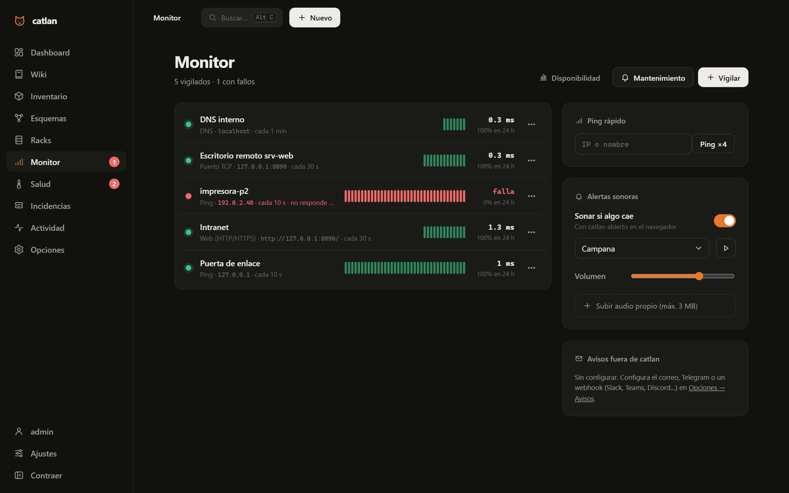 | **Monitor** · ping, puertos TCP, webs, certificados SSL y DNS cada pocos segundos. Avisa en pantalla, con el **sonido de cada dispositivo** y por correo, Telegram o webhook. Si cae un switch, avisa de él y no de todo lo que cuelga de él. Informe mensual de disponibilidad. |
| 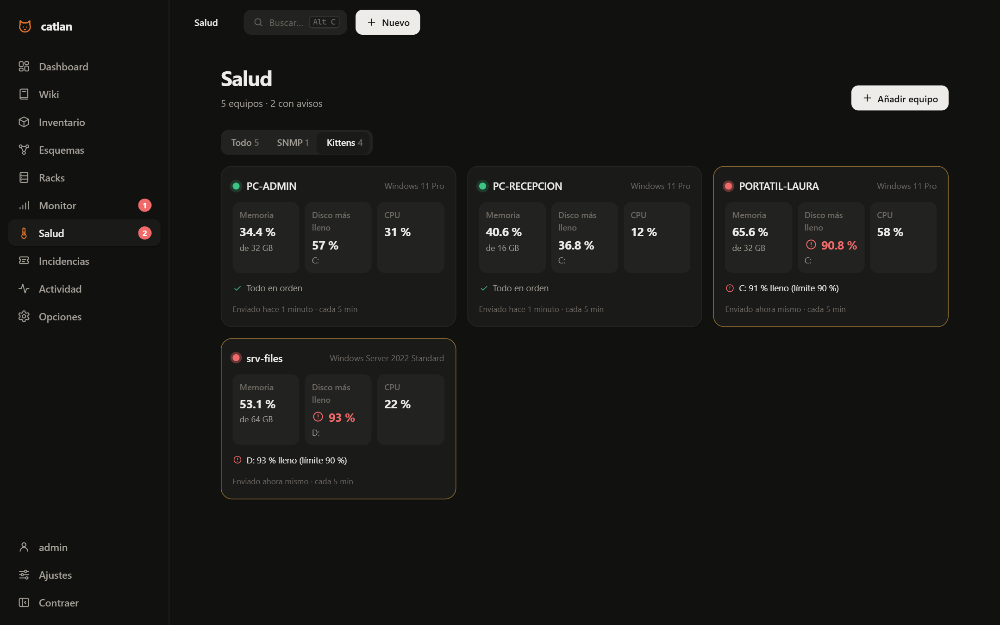 | **Hardware** y **PCs (Kitty)** · temperaturas, discos, ventiladores, RAID y puertos por **SNMP v2c y v3** (Synology, QNAP, Cisco, HP/Aruba, Ubiquiti, MikroTik…), grabadores Hikvision y **PCs con Kitty**, con gráficos de hasta 90 días. |
| 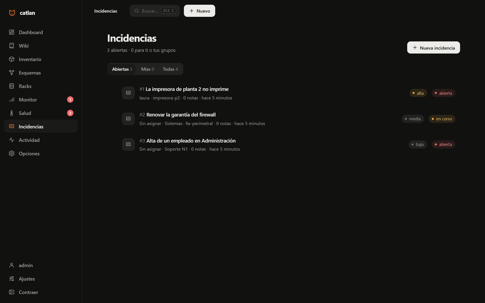 | **Incidencias** · prioridad, estado, persona o grupo asignado, seguimiento e incidencias hijas, en lista o en **tablero**, con tus **tareas y notas personales** al lado. Los usuarios las abren **desde Kitty**, en su PC; las críticas avisan por tus canales. |
| 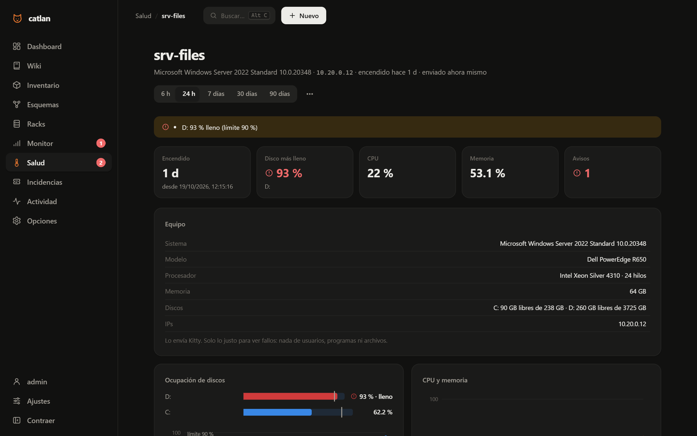 | **Control remoto** · ver y manejar la pantalla de un PC con Kitty desde el navegador, siempre con el permiso de quien lo está usando. Sin abrir puertos en el PC y con registro de cada sesión. |
| 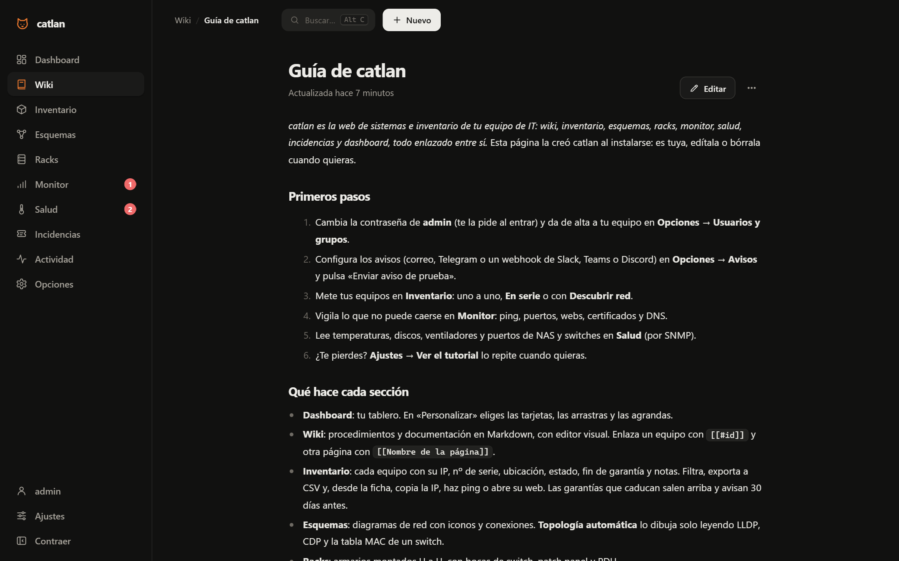 | **Wiki** · procedimientos en Markdown con editor visual. `[[#id]]` enlaza un equipo, `[[INC-n]]` una incidencia y `[[Página]]` otra página. Una instalación nueva trae la **Guía de catlan**. |
| 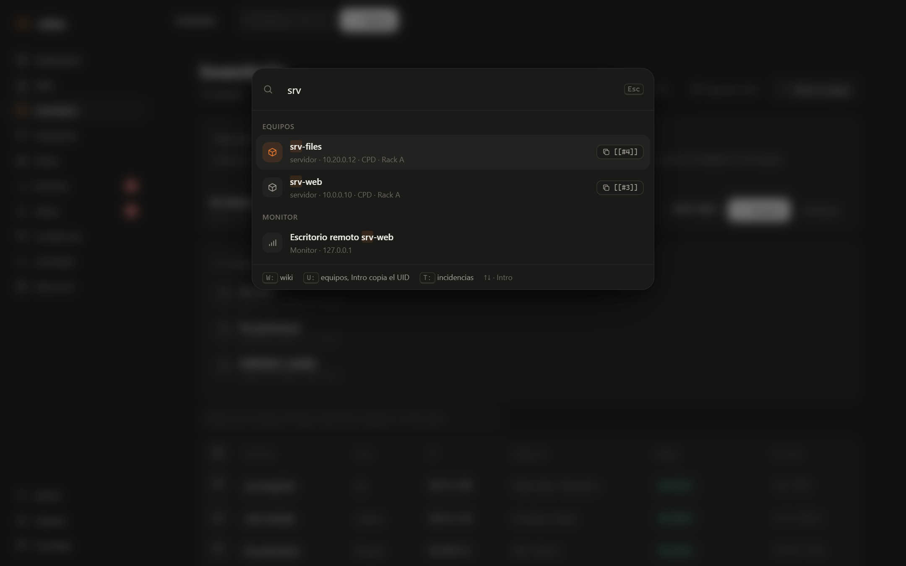 | **Buscador global** (`Alt+C` o `/`) · busca en todo; `W:` wiki, `U:` equipos, `T:` incidencias. |
| 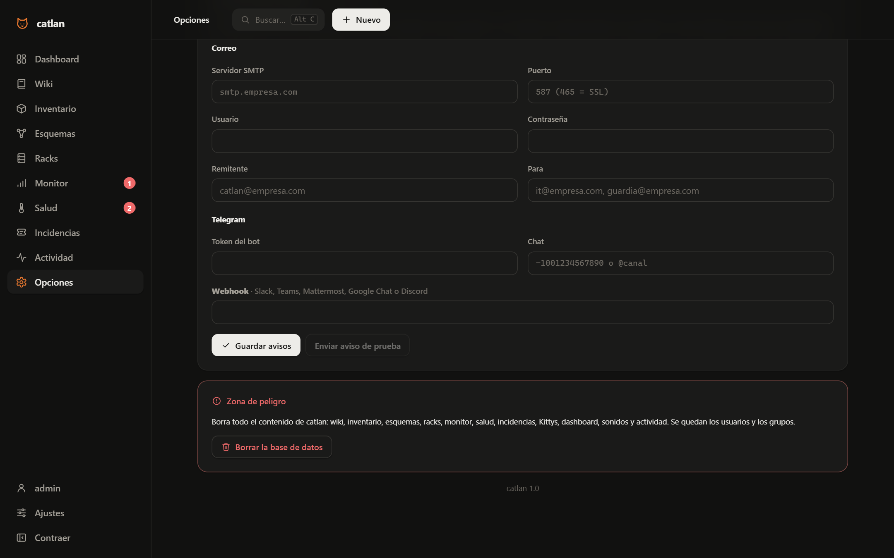 | **Administración** (administradores) · usuarios y grupos con permisos de edición o solo vista, **avisos** configurables con prueba, **copia de seguridad** descargable y zona de peligro. |

Además: **dashboard** personalizable (arrastrar, agrandar, líneas, barras o tarta), **Actividad** con una foto de cada versión,
**tutorial** guiado la primera vez, aviso si dos personas editan lo mismo a la vez, **deshacer** (`Ctrl+Z`) al borrar,
**cambios en lote** en el inventario, **mantenimientos programados**, **verificación en dos pasos**, una página de
**Sistema** en Administración, y la web se adapta al móvil.

<p align="center">
  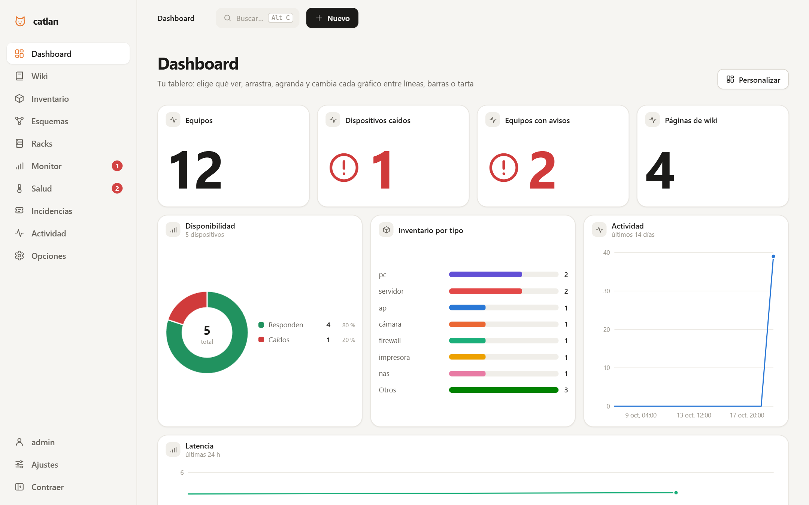
  &nbsp;
  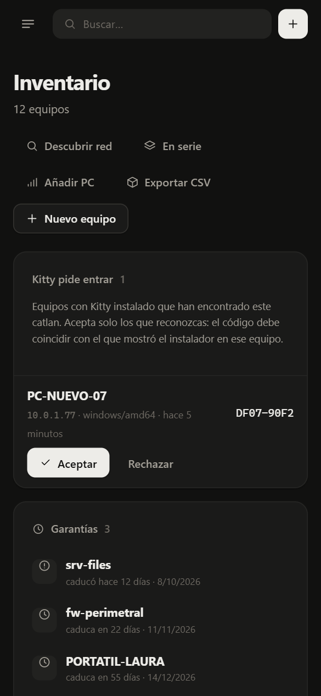
</p>

## Arranque rápido

Compílalo con Rust 1.85 o más nuevo ([rustup.rs](https://rustup.rs)):

```bash
git clone https://github.com/TRristan/catlan.git
cd catlan
cargo build --release              # el servidor: target/release/catlan (en Windows, catlan.exe)
cargo build --release -p kitty     # solo en Windows: kitty.exe, el programa de los PCs
./target/release/catlan
```

El ejecutable no necesita nada más: cópialo donde quieras (con `kitty.exe` al lado, si lo usas). Los datos van a
`data/`, junto a él. O con Docker:

```bash
docker compose up -d
```

Abre **http://localhost:8080** y entra con **admin / admin**: catlan te pide cambiar la contraseña antes de nada.

¿Contraseña olvidada? Un administrador te pone una nueva en **Administración → Usuarios y grupos**. Si eres el único administrador,
en el servidor (no hace falta parar catlan):

```bash
catlan restablecer admin          # o: docker compose exec catlan catlan restablecer admin
```

Saca una contraseña provisional (se pide cambiarla al entrar), quita la verificación en dos pasos de ese usuario y cierra
sus sesiones. Sin usuario, lista los que hay.

## Vienes de la versión en Python

Todo sigue igual por dentro: misma base de datos (con sus migraciones numeradas), mismos usuarios y contraseñas, mismas
copias cifradas, misma web y misma API. Para pasarte:

1. Para catlan (`Ctrl+C` o `docker compose down`) y haz una copia de la carpeta `data/`.
2. Compila (o descarga) `catlan` y ponlo **en la carpeta donde estaba `catlan.py`**, junto a `data/`; o indica la
   carpeta con `CATLAN_DATA`. Ya no hacen falta `catlan.py`, `index.html` ni Python.
3. Arráncalo. Al ver la base de datos, aplica lo que falte y guarda antes una copia en `data/`.

Los comandos cambian de nombre, no de uso: `python catlan.py restablecer` → `catlan restablecer`, y
`python catlan.py descifrar` → `catlan descifrar`. Los Kitty que ya tenías instalados **siguen enviando** con su tarea
programada de PowerShell; vuelve a pegar la línea de instalación en cada PC para pasar al programa nuevo con su
ventana: conserva la ficha del equipo.

## Mini tutorial: los primeros 10 minutos

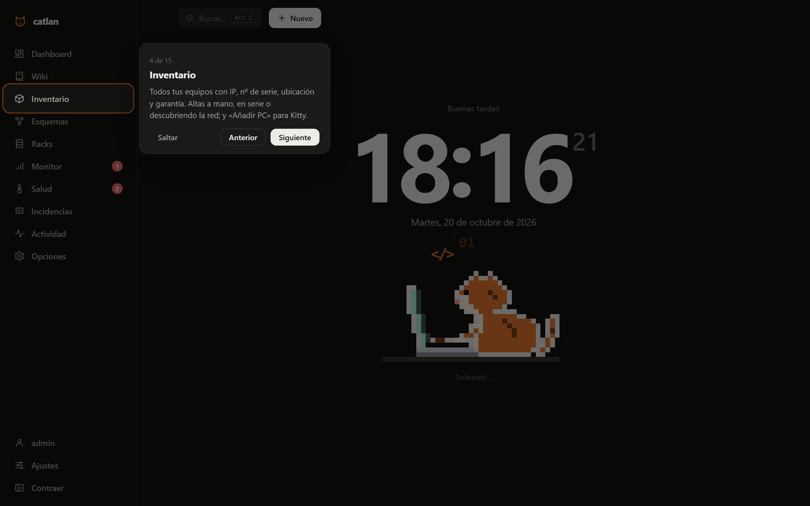

1. **Al entrar**, un tutorial te enseña dónde está cada cosa (se repite en **Mi cuenta → Ayuda**). En la Wiki tienes la
   **Guía de catlan** con todo el detalle.
2. **Tu equipo de trabajo**: en **Administración → Usuarios y grupos** pega una lista de nombres (o una columna de Excel) y
   reparte permisos con grupos de *edición* o de *solo vista*.
3. **Avisos**: en **Administración → General** pon tu correo, un bot de Telegram o un webhook de Slack, Teams o Discord, y
   pulsa «Enviar aviso de prueba».
4. **Inventario**: **Descubrir red** con tu red (por ejemplo `10.0.0.0/24`) y añade lo que encuentre, o usa **En serie**
   para dar de alta muchos equipos de golpe.
5. **Monitor**: «Vigilar» lo que no puede caerse; elige cada cuánto y qué sonido suena si cae.
6. **Hardware**: «Añadir equipo» con la IP y la comunidad SNMP de tu NAS o switch. Desde ahí, **Dibujar topología**.
7. **PCs**: en **Inventario → Añadir con Kitty** copia una línea, pégala en PowerShell como administrador en el PC y
   acéptalo cuando pida entrar. Aparecerá en **PCs (Kitty)**.

## Kitty: el gato de catlan en cada PC

<p align="center">
<picture>
  <source media="(prefers-color-scheme: dark)" srcset="docs/logo/kitty/kit/kitty-horizontal-dark.svg">
  
</picture>
</p>

El comando de **Inventario → Añadir con Kitty** (Windows PowerShell como administrador) instala **Kitty**, un programa pequeño
(`kitty.exe`, unos 3,5 MB, en `Archivos de programa\Kitty`) que reparte el propio catlan:

- **Cada 15 segundos**, `kitty servicio` (una tarea programada que arranca con el PC, como SYSTEM) envía **solo** nombre, sistema,
  modelo, CPU, memoria, discos, IPs, tiempo encendido, nº de serie y, cada 5 minutos, los **errores y críticos del Visor de
  eventos** (Sistema y Aplicación, con las rutas de usuario tapadas), que se ven en su ficha de PCs (Kitty); un crítico, como un apagado
  inesperado, avisa. También el **estado de parches** (último instalado, pendientes cada 6 horas y reinicio pendiente:
  avisa si un PC pasa 30 días sin parchear) y un **semáforo de seguridad** (antivirus y sus firmas, firewall,
  BitLocker y la cuenta Administrador de serie). Nada de usuarios, procesos ni archivos.
- **Programas instalados, solo si lo activas** en **PCs (Kitty) → Programas → Inventario de programas** (apagado de
  serie): nombre, versión y editor de lo que sale en «Aplicaciones instaladas», enviado cuando cambia. Se ven en la
  ficha de cada PC y se buscan con **Alt+C** («¿quién tiene AnyDesk?»). Al apagarlo se borra lo recogido. Los
  portables y las apps de la Tienda no salen; Kitty para Linux y la de PowerShell no lo envían.
- **Un gato en la bandeja** de cada usuario: una ventana con el diseño de catlan para **avisar a IT** («¿Qué está
  fallando?»), seguir **sus avisos** (recibido, en curso, resuelto) y ver **cómo va el PC** en vivo. Cada aviso llega
  a catlan como una incidencia enlazada a la ficha del equipo; si es urgente, avisa por correo, Telegram o webhook.
  La ventana comprueba cada 3 s si llega a catlan y lo muestra arriba.
- **Control remoto** cuando IT lo pide: la ventana pregunta «¿Permitir?» (si nadie responde en 60 s, se rechaza sola).
  Si el usuario acepta, Kitty envía la pantalla (JPEG, solo cuando cambia, hasta unos 10 por segundo) y aplica el ratón
  y el teclado del técnico. Una barra avisa mientras dura y tiene un botón para **cortar**.
- **Se actualiza solo**: cada 5 minutos el servicio compara su `kitty.exe` con el que reparte catlan y, si cambia, lo
  descarga, comprueba su sha256 y se reemplaza; la ventana de cada usuario se reabre con el nuevo.
- **Instala y actualiza programas** que IT elige en **PCs (Kitty) → Programas**, con winget (incluido en
  Windows 10 y 11). Los instala para todo el equipo y busca actualizaciones cada hora. Quitar uno de la lista no lo
  desinstala.
- **Avisos de IT** en **PCs (Kitty) → Avisos**: «El correo estará caído de 14 a 15 h» a todos los PCs o a unos
  cuantos. La ventana de Kitty se abre sola para enseñarlo.
- **Habla con IT** desde «Mis avisos»: el usuario ve las notas que IT marca como visibles en la incidencia y contesta.
  Si IT responde, Kitty se abre sola. Al avisar puede **adjuntar una captura de pantalla**, y mientras escribe Kitty le
  sugiere las **páginas de la wiki marcadas para autoayuda** («Sugerir en Kitty» al editarla).
- **Scripts de PowerShell** en **PCs (Kitty) → Scripts** (solo administradores): se lanzan en uno o varios PCs, Kitty
  los ejecuta como SYSTEM (solo por https, hasta 10 minutos) y la salida queda en la ficha del equipo y en Actividad.
- **Archivos en el control remoto**: el técnico envía un archivo a Descargas del usuario o pide uno por su ruta (hasta
  20 MB, con los permisos del usuario, que ve un aviso de cada uno).
- **Encender el PC** desde su ficha (Wake-on-LAN, con la MAC que manda Kitty): llega a la red de catlan y a la /24 del
  PC si el router deja pasar la difusión.
- **Arranca solo** al iniciar sesión (clave `Run` de Windows) y **solo un administrador de catlan puede cerrarlo**
  desde «Salir de Kitty». Sin conexión con catlan, no se puede cerrar desde el menú. La X de la ventana solo la esconde.

Un administrador acepta cada PC en catlan; hasta entonces no envía eventos ni deja abrir incidencias. La clave del
equipo solo la lee SYSTEM; la ventana usa otra, que solo sirve para abrir incidencias de ese PC (como mucho 10 por
hora). Volver a pegar la línea actualiza Kitty sin perder la ficha. Para quitarlo, en PowerShell como administrador:

```powershell
Unregister-ScheduledTask Kitty -Confirm:$false; Stop-Process -Name kitty -Force; Remove-ItemProperty HKLM:\SOFTWARE\Microsoft\Windows\CurrentVersion\Run Kitty; Remove-Item -Recurse "$env:ProgramFiles\Kitty", "$env:ProgramData\Kitty", HKLM:\SOFTWARE\Kitty
```

catlan reparte `kitty.exe` si está **junto a su ejecutable** o en su carpeta de datos (en Docker, en `/data`).

En **Linux** (con curl), el comando `curl … /kitty.sh | sudo sh` de la misma ventana deja un temporizador de systemd (o cron)
que envía lo mismo **cada 5 minutos**, con los errores y críticos del journal (sin ventana ni control remoto). Para quitarlo:
`sudo sh /usr/local/lib/kitty-agent.sh quitar`.

## Tus datos

- Todo vive en **`data/catlan.db`** (SQLite) en la máquina donde corre catlan.
- catlan **solo se conecta** a los equipos y redes que tú le pidas vigilar, leer o descubrir, y a los canales de aviso
  que configures (tu servidor de correo, `api.telegram.org` si pones un bot, tu webhook).
- Contraseñas de usuario con PBKDF2-SHA256 (600 000 iteraciones); 10 intentos fallidos bloquean la IP 15 minutos.
- **Verificación en dos pasos** (TOTP, cualquier app de autenticación) desde el menú de tu usuario. Quien la tiene no
  entra por Basic; si pierde el móvil, un administrador se la quita.
- Las credenciales de SNMP y de los avisos nunca salen por la web. Van en la copia de seguridad, por eso la copia que
  baja la web **va cifrada con una contraseña** (PBKDF2 + SHAKE-256 + HMAC-SHA256).
- **HTTPS siempre**: sin `CATLAN_CERT`, catlan crea un certificado autofirmado en `data/tls.pem` y escribe su huella
  SHA-256 al arrancar (y en **Administración → Sistema**). El comando de instalación de Kitty lleva esa huella: PowerShell, curl y
  Kitty solo hablan con ese certificado, y el instalador comprueba el SHA-256 de `kitty.exe` antes de ponerlo. En claro
  (HTTP) solo responde al propio equipo, a los proxies de `CATLAN_PROXIES` y a la telemetría de las Kitty instaladas
  antes; la web redirige a https, y sin cifrar no hay login, control remoto ni actualizaciones de Kitty.
  **Las Kitty de antes siguen enviando el estado, pero hay que reinstalarlas** (mismo comando) para el control remoto,
  las actualizaciones y el anclaje.

## Usuarios del dominio (LDAP y OIDC)

En **Administración → General → Inicio de sesión con el dominio** (solo administradores). Se puede poner uno, otro o los dos.

- **Active Directory / LDAP.** Servidor (`ldaps://dc1.empresa.local`) y dominio (`empresa.local`). catlan hace el bind
  **con el propio usuario** (`juan@empresa.local`; vale escribir `juan`, `juan@empresa.local` o `EMPRESA\juan`), le pregunta
  al dominio quién es («¿quién soy?», RFC 4532) y busca su ficha por `sAMAccountName` para leer sus grupos (`memberOf`).
  No hace falta cuenta de servicio. Solo **LDAPS**: con LDAP en claro la contraseña viajaría por la red. Si el
  certificado del controlador no es de una CA que conozca el sistema, pega su huella SHA-256.
- **OIDC** (Entra ID, Google Workspace, Keycloak…). El emisor (`https://login.microsoftonline.com/<tenant>/v2.0`,
  `https://accounts.google.com`, `https://keycloak.empresa.com/realms/empresa`), el id y el secreto del cliente. Da de alta
  como dirección de vuelta la que enseña catlan (`https://catlan.empresa.local/api/sso/callback`). Flujo de código con
  PKCE (S256), `state` atado al navegador y `nonce`. En la página de login sale el botón «Entrar con…».
  Los grupos salen del claim `groups` (o el que digas): en Entra, activa «groups claim» en la app; en Keycloak, el mapper
  «Group Membership». **Google no manda grupos**: su dominio de correo verificado cuenta como el grupo `@empresa.com`.
- **Grupos con acceso**, uno por línea: `grupo del dominio | grupo de catlan` o `grupo del dominio | admin`. El grupo
  del dominio puede ir con su nombre (`IT`) o con el DN entero (`CN=IT,OU=Grupos,DC=empresa,DC=local`, entonces solo
  ese). Quien no está en ninguno no entra. En cada entrada, sus grupos del dominio mandan su admin y sus grupos de catlan
  (edición o solo vista); la contraseña y la verificación en dos pasos son las del dominio.
- **Los usuarios locales siguen funcionando siempre**, `admin` incluido: entran con su contraseña de catlan aunque el
  dominio no conteste, y un usuario del dominio con el mismo nombre nunca toma el local (no entra hasta que un
  administrador borre el local). Deja `admin` con una contraseña larga y verificación en dos pasos como entrada de
  emergencia.
- Mismo límite de intentos que los locales (por IP y por usuario). El dominio caído no cuenta como intento fallido.
- Las sesiones de los usuarios del dominio duran **12 horas** (las locales, 30 días): quien sale de la empresa deja de
  entrar ese mismo día. Por Basic (scripts), la contraseña del dominio se recuerda 10 minutos.

## Actualizar catlan

catlan solo se conecta a GitHub si un administrador lo pide. En **Administración → Sistema → Actualizaciones**:

- **Buscar actualizaciones** mira la última versión publicada en
  [Releases](https://github.com/TRristan/catlan/releases).
- **Actualizar ahora** la descarga, comprueba su sha256 con el `SHA256SUMS` de la versión, reemplaza el ejecutable y
  reinicia catlan. Antes de tocar la base de datos, catlan guarda una copia, como siempre.
- **Actualizar solo** lo hace una vez al día.

Funciona con el ejecutable en Linux y Windows de 64 bits. En **Docker**, actualiza la imagen. Si catlan corre como
servicio de systemd, ponle `Restart=on-failure`: al actualizarse, sale para que systemd lo arranque con la versión nueva.

Para publicar una versión: sube la versión en `Cargo.toml`, haz commit y crea la etiqueta (`git tag v1.1.0 && git push
--tags`). GitHub Actions compila catlan para Linux y Windows y Kitty, y publica la versión con su `SHA256SUMS`.

## Configuración

Todo se configura desde la web. Opcionalmente, con variables de entorno:

| Variable | Por defecto | Qué hace |
|---|---|---|
| `CATLAN_PORT` | `8080` | Puerto |
| `CATLAN_DATA` | `data/` junto al ejecutable | Carpeta de la base de datos |
| `CATLAN_PASSWORD` | (vacío) | Contraseña inicial de `admin`. Vacía: `admin`, a cambiar al entrar |
| `CATLAN_SYSLOG_PORT` | `514` | Puerto UDP del receptor de syslog (`0`: sin syslog; en Linux, 514 necesita root o `CAP_NET_BIND_SERVICE`) |
| `CATLAN_CERT` · `CATLAN_KEY` | (vacío) | Certificado y clave propios (PEM). Vacío: autofirmado en `data/tls.pem` |
| `CATLAN_PROXIES` | `127.0.0.1,::1` | Proxies de confianza: solo de ellos se cree `X-Forwarded-For` y `X-Forwarded-Proto` |
| `CATLAN_SMTP_HOST` · `_PORT` · `_USER` · `_PASS` | (vacío) · `587` | Correo de avisos (465 = SSL directo). Lo de **Administración → General** manda sobre esto |
| `CATLAN_MAIL_FROM` · `CATLAN_MAIL_TO` | (vacío) | Remitente y destinatarios (separados por comas) |
| `CATLAN_TELEGRAM_TOKEN` · `CATLAN_TELEGRAM_CHAT` | (vacío) | Avisos por Telegram |
| `CATLAN_WEBHOOK_URL` | (vacío) | Slack, Teams, Discord, Mattermost o Google Chat |

## Copias de seguridad

**Administración → Descargar copia de seguridad** baja toda la base de datos cifrada con la contraseña que elijas (`.catlan`);
o copia `data/catlan.db` con catlan parado. Para restaurar, con catlan parado:

```bash
catlan descifrar catlan-20261120-1800.catlan data/catlan.db
```

Además, catlan hace **una copia al día** en `data/backups/` y guarda las 7 últimas (se ven en **Administración →
Sistema**). Para restaurar una, con catlan parado, cópiala sobre `data/catlan.db`.

Al arrancar, catlan comprueba la base de datos (`PRAGMA integrity_check`), aplica las migraciones que falten (numeradas,
guarda una copia antes) y se niega a abrir una base de datos de una versión más nueva. Usa SQLite en modo WAL: aguanta
mejor los cortes de luz, las lecturas no esperan a las escrituras y, al pararlo (`Ctrl+C` o `docker stop`), termina la
escritura en curso y lo deja todo dentro de `catlan.db`. Si el monitor deja de latir, la web lo avisa en todas las vistas.

## El repositorio

```text
src/          el servidor (Rust)
  server.rs     HTTPS y HTTP en el mismo puerto (tokio + hyper), límites por conexión e IP
  web/          la API: una tabla de rutas por área (inventario, wiki, monitor, incidencias, usuarios, Kitty,
                remoto), con el permiso de cada ruta, que comprueba un middleware; sesiones y WebSockets
  remote.rs     control remoto: el relevo entre la web del técnico y la Kitty del PC
  update.rs     actualizar catlan desde GitHub (Releases)
  db.rs         SQLite: esquema y migraciones numeradas
  monitor.rs    comprobaciones, avisos, resúmenes, SLA, syslog e IPAM
  snmp.rs       SNMP v2c y v3 (BER a mano, firma y cifrado USM)
  health.rs     perfiles por fabricante, interfaces, topología y Kitty
  crypto.rs     contraseñas, copias cifradas y TOTP
  ui/           la web (HTML, CSS y JS sin dependencias): index.html, css/ y js/; build.rs la une
                en una sola página dentro del ejecutable, en orden de nombre (10-…, 20-…)
kitty/        Kitty: el programa de los PCs (kitty.exe) y sus instaladores (kitty.ps1, kitty.sh)
  src/app.rs    la bandeja y la ventana (WebView2)
  src/remote.rs el control remoto: captura de pantalla, ratón y teclado
  src/net.rs    hablar con catlan y enviar el estado del PC
  src/update.rs actualizarse solo con el kitty.exe de catlan
  src/apps.rs   instalar y actualizar los programas que elige IT (winget)
tests/        tests de la API contra el ejecutable (Python, sin dependencias) y de la web en
              un navegador (test_ui.py, con Playwright)
docs/         capturas, y en docs/logo/ el logo de catlan y de Kitty con su guía
```

## Desarrollo y tests

```bash
cargo test                           # lo interno: BER, AES y claves USM (vectores oficiales), TOTP, copias cifradas, SLA…
cargo build --release
python tests/test_catlan.py          # API completa contra el ejecutable (SMTP, webhook y agentes SNMP de mentira)
pip install snmpsim pysmi cryptography
python tests/test_snmpv3.py          # SNMPv3 contra el simulador snmpsim, en las 7 combinaciones de firma y cifrado
python tests/test_topologia.py       # auto-topología (LLDP, CDP, MAC, ARP) contra snmpsim, por v2c y v3
python tests/carga.py 1000 90         # carga: 1.000 Kitty enviando cada 15 s durante 90 s (aparte: tarda)
```

Los tests de Python prueban el ejecutable desde fuera, por su API, igual que lo usa la web. GitHub Actions compila y
pasa todo en cada cambio (el servidor en Linux, Kitty en Windows).

## Estado y límites conocidos

- La API aún no está documentada (sin OpenAPI) y puede cambiar; los cambios que obliguen a hacer algo suben el primer
  número de la versión.
- La ventana de Kitty es **solo para Windows**; en Linux, Kitty envía el estado del equipo sin ventana.
- La imagen de Docker no incluye `kitty.exe`: cópialo a `/data` para repartirlo.
- Perfiles SNMP de Cisco, HP/Aruba, Ubiquiti, MikroTik y Hikvision **sin probar todavía con hardware real**;
  la auto-topología está probada con agentes simulados (snmpsim), no con un switch físico.
- El control remoto ve y maneja **solo la pantalla principal** del PC.
- Un usuario puede terminar `kitty.exe` desde el Administrador de tareas. El envío del estado no se corta (lo hace
  el servicio de SYSTEM) y Kitty vuelve a abrirse en el siguiente inicio de sesión.
- Con envíos cada 15 s, el historial de métricas ocupa más. Por defecto se borra a los 7 días y las medias por hora se
  guardan 400; los días se cambian en **Administración → Sistema → Cuánto se guarda**.
- Las actualizaciones automáticas de catlan necesitan versiones publicadas en GitHub (Releases); hasta la primera,
  «Buscar actualizaciones» dice que no hay ninguna.
- Usuarios del dominio: solo los grupos directos de AD (sin anidados), sin LDAP en claro ni StartTLS (solo LDAPS), y
  en Entra con más de 200 grupos el id_token no los trae. Probado con un AD y un proveedor OIDC de mentira, no con uno real.
- Programas en los PCs: el mismo conjunto para todos los PCs con Kitty en Windows (no por grupos), y solo programas
  que estén en winget. Probado sin PCs reales todavía.

## Requisitos y límites probados

Con `python tests/carga.py <equipos> <segundos>`: Kitty de mentira, ya aceptados, que envían su estado por HTTPS cada
15 s. En un PC de escritorio de 16 hilos con Windows 11, cliente y catlan en la misma máquina, 90 s por prueba:

| Equipos con Kitty | Envíos/s | Errores | Latencia mediana · p99 | CPU de catlan (100 % = un núcleo) | Memoria |
|---|---|---|---|---|---|
| 500 | 33 | 0 | 5 ms · 29 ms | 7 % (máx. 11 %) | 15 MB |
| 1.000 | 67 | 0 | 5 ms · 30 ms | 15 % (máx. 24 %) | 17 MB |
| 3.000 | 200 | 0 | 7 ms · 32 ms | 54 % (máx. 64 %) | 19 MB |

No incluye el monitor (pings, SNMP) ni a los técnicos usando la web a la vez, y no está medido en máquinas pequeñas
(Raspberry Pi, VM de 1 vCPU): repítela en tu hardware antes de pasar de unos cientos de equipos.

## Licencia

[GPL-3.0](LICENSE): puedes usarlo, estudiarlo, modificarlo y compartirlo; si distribuyes una versión modificada,
tiene que ser también GPL-3.0 y con su código.
