<div align="center">


# catlan

**El gato amigo de los IT.** Inventario, wiki, esquemas de red, racks, monitor, salud de equipos e incidencias en una sola web, autoalojada y 100 % local.

-orange)


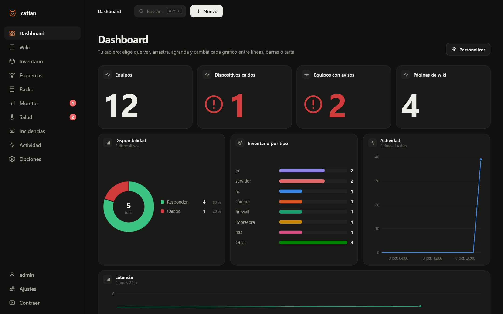

</div>

> [!WARNING]
> **Proyecto en desarrollo (WIP).** Funciona y tiene tests, pero aún cambia a menudo y puede haber fallos.
> **No tiene actualizaciones automáticas ni online**: para actualizar, para catlan, haz una copia de `data/` y sustituye
> `catlan.py`, `index.html` y `kitty.ps1` por los de la nueva versión. Al arrancar, catlan migra su base de datos solo
> (y guarda una copia antes cuando hace falta).

## ¿Qué es?

catlan es la web de un equipo de sistemas para tener **todo enlazado por el ID de cada equipo**: su ficha del inventario,
dónde está montado en el rack, en qué esquema aparece, qué páginas de la wiki lo mencionan, si responde al ping, cómo
van sus discos y qué incidencias tiene abiertas. Con historial de cada cambio.

- **Un archivo de servidor y un HTML.** Python 3.12 con la librería estándar: sin `pip install`, sin frameworks, sin
  compilar. SNMP v2c/v3 (con AES-128) está escrito a mano.
- **Todo local.** Una base de datos SQLite en `data/`. Sin nube, sin cuentas externas, sin analítica ni telemetría; la web
  no carga nada de Internet.
- **En español** y pensada para el día a día de un IT: atajos de teclado, buscador global, tema claro y oscuro, móvil.

## Funciones

| | |
|---|---|
| 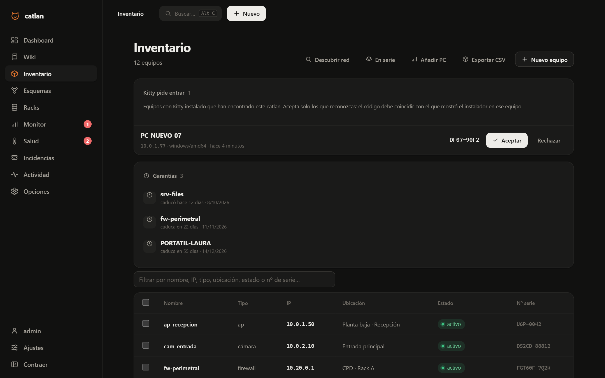 | **Inventario** · equipos con IP, nº de serie, ubicación, estado y fin de garantía. Altas a mano, en serie o **descubriendo la red** (ping, SNMP y DNS). Filtro al vuelo, **exportar a CSV** y las garantías que caducan, arriba y con aviso. |
| 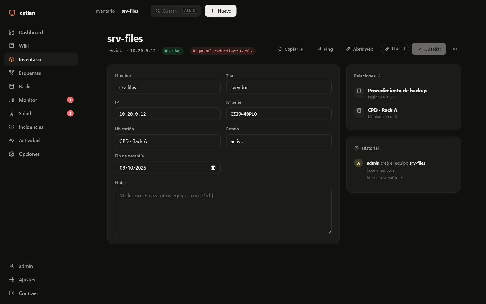 | **Ficha de cada equipo** · copiar IP, ping al momento, abrir su web, su estado en el monitor y todo lo que lo menciona: páginas, esquemas, racks e incidencias. |
| 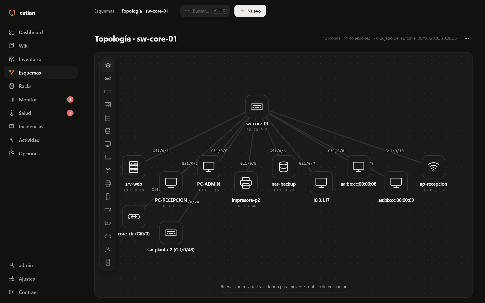 | **Esquemas y topología automática** · diagramas de red con iconos y, con un clic, catlan lee **LLDP, CDP y la tabla MAC** de un switch y dibuja qué equipo está en qué puerto. |
| 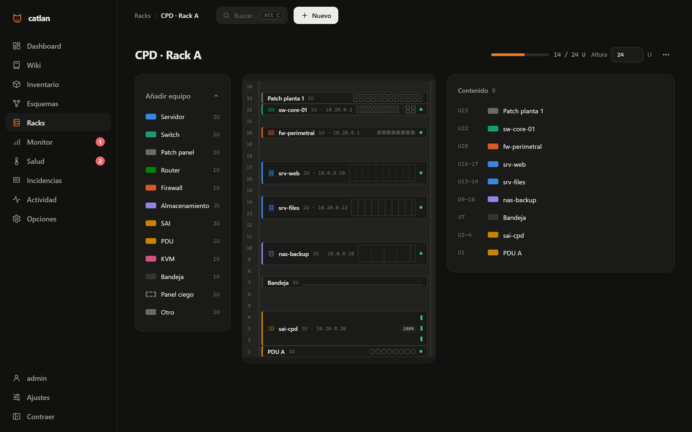 | **Racks** · armarios montados U a U, con bocas de switch, patch panel y PDU anotables. |
| 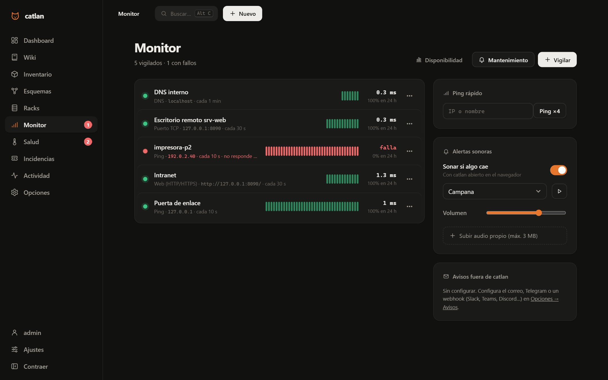 | **Monitor** · ping, puertos TCP, webs, certificados SSL y DNS cada pocos segundos. Avisa en pantalla, con el **sonido de cada dispositivo** y por correo, Telegram o webhook. Si cae un switch, avisa de él y no de todo lo que cuelga de él. Informe mensual de disponibilidad. |
| 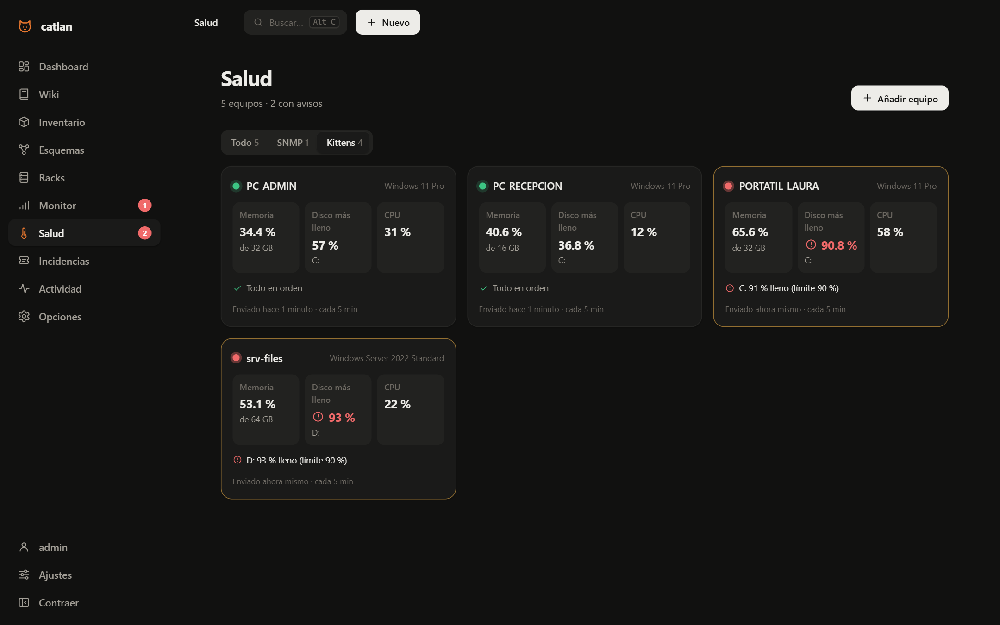 | **Salud** · temperaturas, discos, ventiladores, RAID y puertos por **SNMP** (Synology, QNAP, Cisco, HP/Aruba, Ubiquiti, MikroTik…), grabadores Hikvision y **PCs Windows con Kitty**, con gráficos de hasta 90 días. |
| 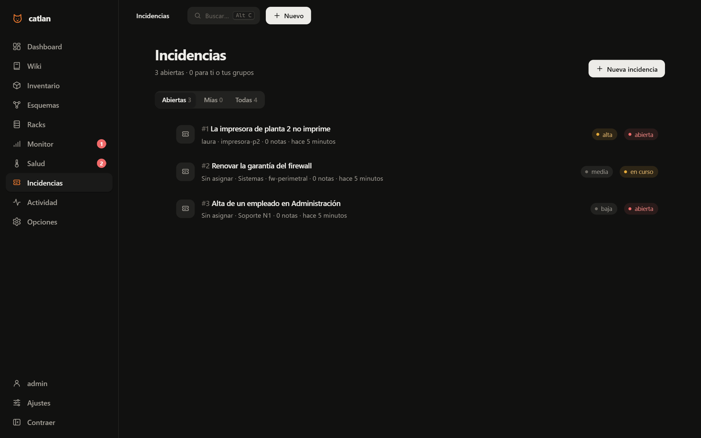 | **Incidencias** · prioridad, estado, persona o grupo asignado, seguimiento e incidencias hijas. Las críticas avisan por tus canales. |
| 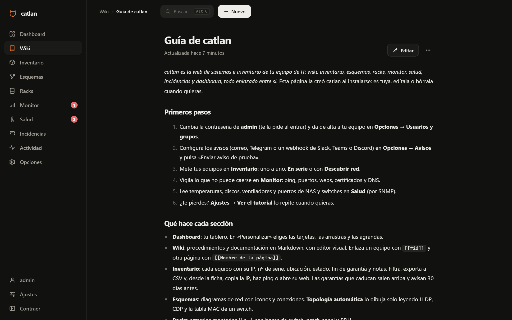 | **Wiki** · procedimientos en Markdown con editor visual. `[[#id]]` enlaza un equipo y `[[Página]]` otra página. Una instalación nueva trae la **Guía de catlan**. |
| 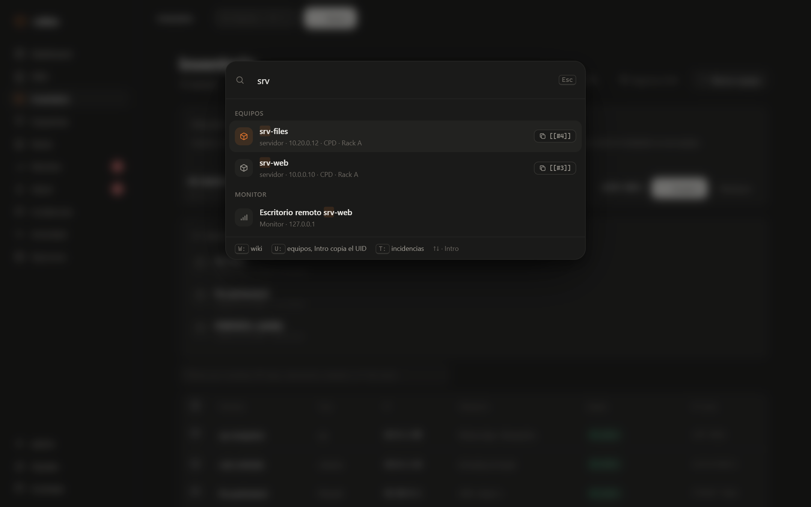 | **Buscador global** (`Alt+C` o `/`) · busca en todo; `W:` wiki, `U:` equipos, `T:` incidencias. |
| 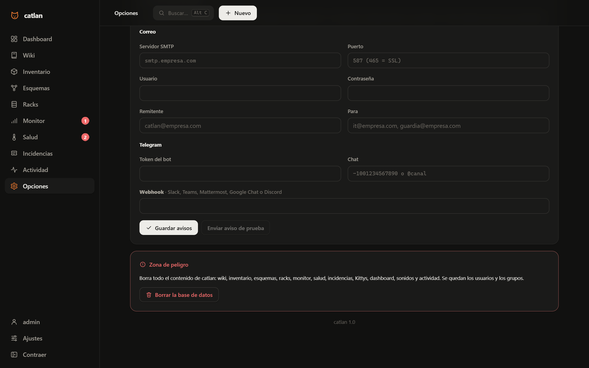 | **Opciones** (administradores) · usuarios y grupos con permisos de edición o solo vista, **avisos** configurables con prueba, **copia de seguridad** descargable y zona de peligro. |

Además: **dashboard** personalizable (arrastrar, agrandar, líneas, barras o tarta), **Actividad** con una foto de cada versión,
**tutorial** guiado la primera vez, aviso si dos personas editan lo mismo a la vez, y la web se adapta al móvil.

<p align="center">
  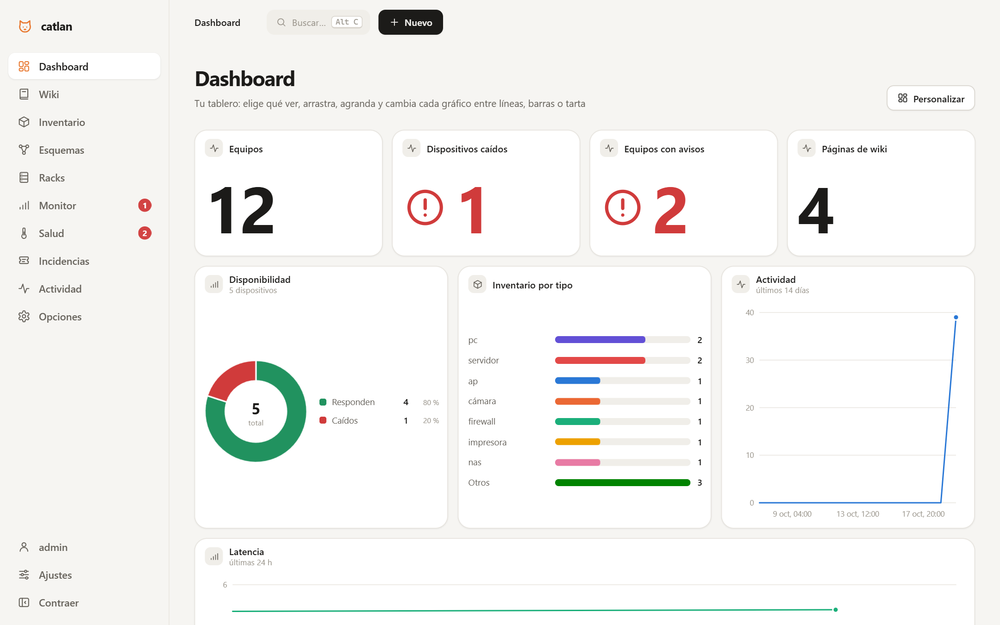
  &nbsp;
  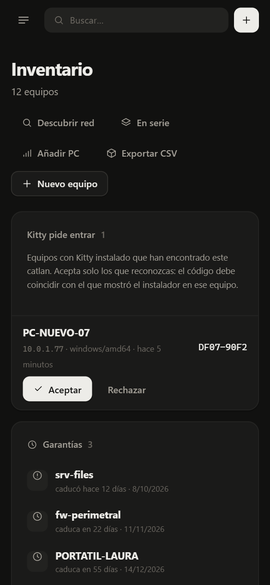
</p>

## Arranque rápido

Con Python 3.12 (nada que instalar):

```bash
git clone https://github.com/TRristan/catlan.git
cd catlan
python catlan.py
```

O con Docker:

```bash
docker compose up -d
```

Abre **http://localhost:8080** y entra con **admin / admin**: catlan te pide cambiar la contraseña antes de nada.

## Mini tutorial: los primeros 10 minutos

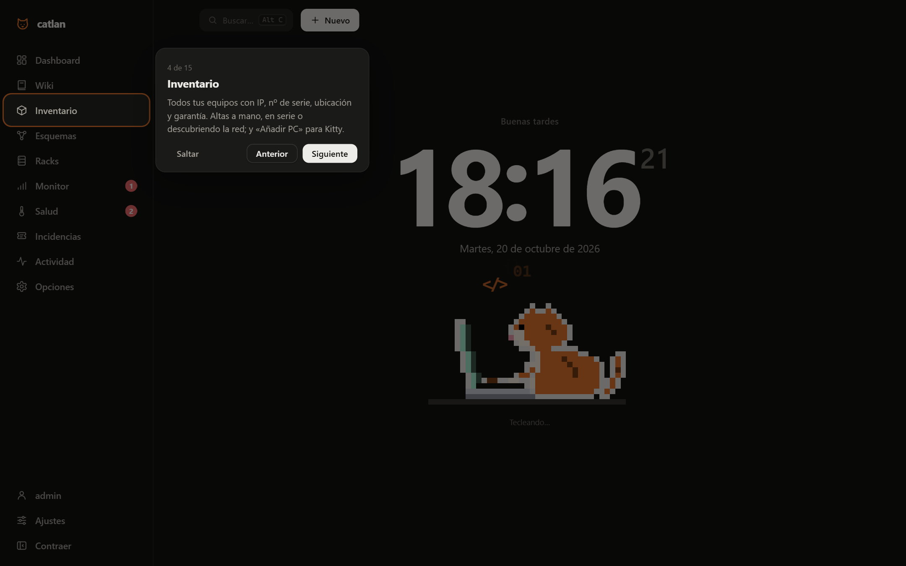

1. **Al entrar**, un tutorial te enseña dónde está cada cosa (se repite en **Ajustes → Ayuda**). En la Wiki tienes la
   **Guía de catlan** con todo el detalle.
2. **Tu equipo de trabajo**: en **Opciones → Usuarios y grupos** pega una lista de nombres (o una columna de Excel) y
   reparte permisos con grupos de *edición* o de *solo vista*.
3. **Avisos**: en **Opciones → Avisos** pon tu correo, un bot de Telegram o un webhook de Slack, Teams o Discord, y
   pulsa «Enviar aviso de prueba».
4. **Inventario**: **Descubrir red** con tu red (por ejemplo `10.0.0.0/24`) y añade lo que encuentre, o usa **En serie**
   para dar de alta muchos equipos de golpe.
5. **Monitor**: «Vigilar» lo que no puede caerse; elige cada cuánto y qué sonido suena si cae.
6. **Salud**: «Añadir equipo» con la IP y la comunidad SNMP de tu NAS o switch. Desde ahí, **Dibujar topología**.
7. **PCs Windows**: en **Inventario → Añadir PC** copia una línea, pégala en PowerShell como administrador en el PC y
   acéptalo cuando pida entrar. Aparecerá en **Salud → Kittens**.

## Kitty: el estado de los PCs Windows, sin instalar programas

`irm http://tu-catlan:8080/kitty.ps1 | iex` deja en el PC una **tarea programada** (cada 5 minutos y al arrancar) con
el script en línea: ningún `.exe` y ningún archivo en el equipo. Un administrador acepta cada PC en catlan, y desde
entonces envía **solo** nombre, sistema, modelo, CPU, memoria, discos, IPs, tiempo encendido y nº de serie. Nada de
usuarios, programas, procesos ni archivos. Para quitarlo:
`Unregister-ScheduledTask Kitty; Remove-Item HKLM:\SOFTWARE\Kitty`.

## Tus datos

- Todo vive en **`data/catlan.db`** (SQLite) en la máquina donde corre catlan.
- catlan **solo se conecta** a los equipos y redes que tú le pidas vigilar, leer o descubrir, y a los canales de aviso
  que configures (tu servidor de correo, `api.telegram.org` si pones un bot, tu webhook).
- Contraseñas de usuario con PBKDF2-SHA256 (600 000 iteraciones); 10 intentos fallidos bloquean la IP 15 minutos.
  Las credenciales de SNMP y de los avisos nunca salen por la web, pero **sí van en la copia de seguridad**: guárdala
  como algo sensible.
- **Sin HTTPS propio**: si catlan sale de tu red local, ponlo detrás de un proxy con HTTPS (Caddy, nginx, Traefik).

## Configuración

Todo se configura desde la web. Opcionalmente, con variables de entorno:

| Variable | Por defecto | Qué hace |
|---|---|---|
| `CATLAN_PORT` | `8080` | Puerto |
| `CATLAN_DATA` | `./data` | Carpeta de la base de datos |
| `CATLAN_PASSWORD` | (vacío) | Contraseña inicial de `admin`. Vacía: `admin`, a cambiar al entrar |
| `CATLAN_SMTP_HOST` · `_PORT` · `_USER` · `_PASS` | (vacío) · `587` | Correo de avisos (465 = SSL directo). Lo de **Opciones → Avisos** manda sobre esto |
| `CATLAN_MAIL_FROM` · `CATLAN_MAIL_TO` | (vacío) | Remitente y destinatarios (separados por comas) |
| `CATLAN_TELEGRAM_TOKEN` · `CATLAN_TELEGRAM_CHAT` | (vacío) | Avisos por Telegram |
| `CATLAN_WEBHOOK_URL` | (vacío) | Slack, Teams, Discord, Mattermost o Google Chat |

## Copias de seguridad

**Opciones → Descargar copia de seguridad** baja toda la base de datos en un archivo `.db`; o copia `data/catlan.db`
con catlan parado. Para restaurar, sustituye `data/catlan.db` por la copia.

## Desarrollo y tests

```bash
python test_catlan.py        # API completa, sin instalar nada (servidor, SMTP, webhook y agentes SNMP de mentira)
pip install snmpsim pysmi cryptography
python test_snmpv3.py        # SNMPv3 contra el simulador snmpsim
python test_topologia.py     # auto-topología (LLDP, CDP, MAC, ARP) contra snmpsim, por v2c y v3
```

`catlan.py` es el servidor (API, autenticación, monitor, SNMP y SQLite) e `index.html` es toda la web (HTML, CSS y JS
sin dependencias).

## Estado y límites conocidos

- **WIP**: la interfaz y la API pueden cambiar entre versiones.
- Perfiles SNMP de Cisco, HP/Aruba, Ubiquiti, MikroTik y Hikvision **sin probar todavía con hardware real**;
  la auto-topología está probada con agentes simulados (snmpsim), no con un switch físico.
- Esquemas, racks e incidencias: si dos personas editan a la vez, gana la última (la wiki y el inventario sí avisan).
- Sin HTTPS propio ni actualizaciones automáticas.

## Licencia

[GPL-3.0](LICENSE): puedes usarlo, estudiarlo, modificarlo y compartirlo; si distribuyes una versión modificada,
tiene que ser también GPL-3.0 y con su código.
