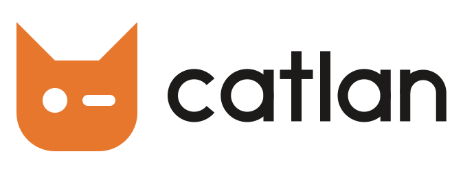
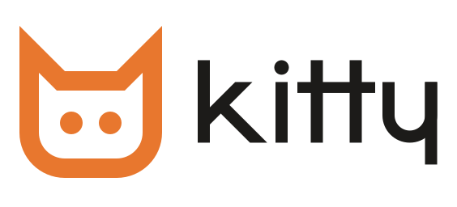

# catlan — logo y guía de uso

## 1. El logo

**Idea:** el gato amigo de los IT, con un ojo encendido y otro que te guiña. Es una cabeza de gato
geométrica: orejas a 45°, mandíbula de dos arcos y ojos huecos. El nombre está hecho con círculos y
barras del mismo grosor (anillo de la `a` = palo de la `l`).

| Versión | Archivo | Uso |
|---|---|---|
| Horizontal (principal) | `kit/catlan-horizontal.svg` | cabecera de la web, README, documentos |
| Apilada | `kit/catlan-stacked.svg` | portadas, espacios cuadrados |
| Símbolo | `kit/catlan-symbol.svg` | avatar, bandeja de Kitty, iconos |
| Símbolo pequeño | `kit/catlan-symbol-small.svg` | por debajo de 32 px (ojos más grandes) |
| Solo nombre | `kit/catlan-wordmark.svg` | cuando el gato ya aparece cerca |
| Una tinta | `*-black.svg`, `*-white.svg`, `*-mono-e8772e.svg` | grabado, sellos, fondos de color |
| Invertida | `kit/catlan-horizontal-reversed.svg` | tema oscuro |
| Iconos web | `kit/favicon.ico`, `favicon.svg`, `icon-*.png`, `site.webmanifest`, `head-snippet.html` | navegador, PWA, móvil |

Los SVG de catlan y de Kitty se generan con `python build.py` (símbolo, nombre y composiciones) y con el
`export_variants.py` de la skill de logos (variantes e iconos web).

## 2. Espacio libre

Alrededor del logo deja libre como mínimo **1 ojo** (el diámetro del ojo redondo) por cada lado.
Esa distancia crece y se reduce con el logo: no es una medida fija.

## 3. Tamaño mínimo

| Versión | Pantalla | Impresión |
|---|---|---|
| Horizontal | 96 px de ancho | 25 mm de ancho |
| Símbolo | 16 px, con el archivo `-small` o `favicon` | 6 mm |

## 4. Color

| Nombre | HEX | RGB | CMYK | Pantone (aprox.) |
|---|---|---|---|---|
| Naranja catlan | `#e8772e` | 232 · 119 · 46 | 0 · 49 · 80 · 9 | 158 C |
| Tinta | `#1c1b19` | 28 · 27 · 25 | 0 · 4 · 11 · 89 | Neutral Black C |
| Papel | `#f6f5f2` | 246 · 245 · 242 | — | — |
| Noche | `#111110` | 17 · 17 · 16 | — | — |

Son los mismos colores que ya usa la web (`--acc`, `--tx`, `--bg`).

**Combinaciones aprobadas:** gato naranja con nombre en tinta sobre blanco o papel · gato naranja con
nombre claro sobre noche · todo en blanco sobre naranja · todo en negro sobre blanco.

El naranja sobre blanco tiene un contraste de unos 3:1. Sirve para el logo, pero no para texto pequeño.

## 5. Tipografía

El nombre está dibujado a mano: no es una fuente, así que no hay licencia que comprobar. No lo
escribas con una fuente: usa siempre los archivos. Para el resto de textos, sigue la tipografía de
sistema que ya usa la web.

## 6. Qué no hacer

No estires ni aplastes el logo · no lo gires · no abras el ojo que guiña ni cambies los ojos ·
no le pongas sombras, contornos ni degradados · no cambies los colores fuera de la paleta · no
muevas ni cambies el tamaño de las partes de una composición · no lo pongas sobre fondos cargados sin
un recuadro.

## 7. Kitty

**Idea:** el gato de catlan en hueco. catlan, el servidor, es el gato sólido; Kitty, el agente de cada PC,
es la versión ligera. La cabeza es la misma (orejas a 45°, mandíbula de radio 56), convertida en un
contorno de 24 unidades. Los ojos son dos puntos llenos, sin guiño: Kitty está atento.

- **Archivos:** `kitty/kit/` tiene los mismos nombres que el kit de catlan (`kitty-symbol.svg`,
  `-small`, `-horizontal`, `-stacked`, `-wordmark`, una tinta, iconos web).
- **Nombre:** "kitty", en minúscula, con las mismas letras que "catlan". Las dos `t` comparten barra.
  En frases, se escribe Kitty con mayúscula.
- **Color:** el mismo naranja `#e8772e`. Para diferenciar los iconos de app, catlan va en naranja con
  el gato blanco y Kitty en tinta `#1c1b19` con el gato naranja.
- **Pequeño:** por debajo de 32 px usa `kitty-symbol-small.svg` (contorno de 30 y ojos más grandes).
- **Fondo oscuro:** usa `kitty-symbol-reversed.svg` o `kitty-horizontal-reversed.svg`. El contorno es
  2 unidades más fino porque, claro sobre oscuro, se ve más grueso.
- **Espacio libre y tamaño mínimo:** las mismas reglas que catlan (un ojo de catlan; 16 px y 96 px).
- **No:** rellenes el hueco, añadas un guiño (es de catlan) ni pongas los dos gatos juntos al mismo
  tamaño sin decir cuál es cuál.

## 8. Notas

- Las pruebas hechas: render a 16, 32 y 64 px, una tinta, invertido y auditoría de los SVG (99–100/100).
- Antes de usarlo en público, haz una búsqueda de marcas registradas (EUIPO, OEPM y búsqueda inversa de
  imágenes). Este trabajo no la sustituye.
- `board.html` y `slides/` (y lo mismo en `kitty/`) contienen el tablero de presentación con maquetas (README, icono de app,
  web, terminal, pegatina y perfil). `concepts/` guarda los tres conceptos iniciales.
